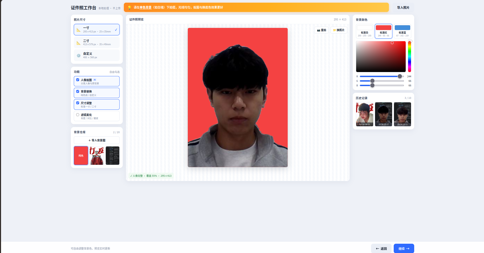
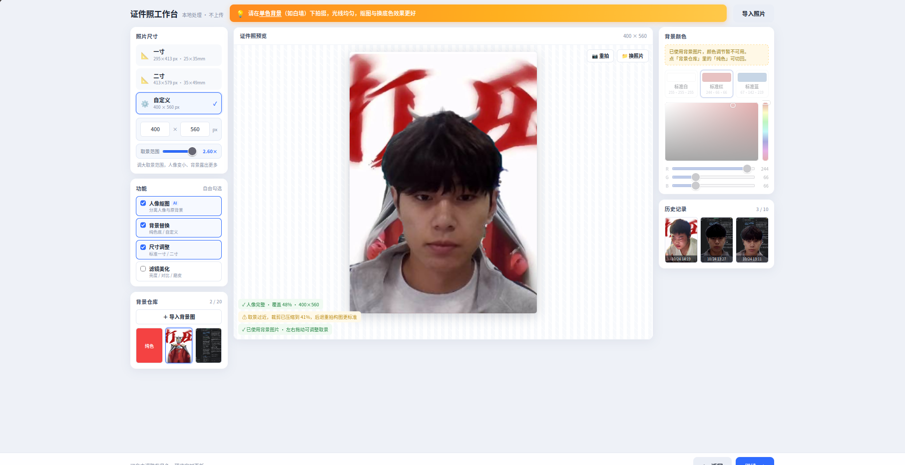

# 证件照自动裁剪与背景替换

输入人像照片，自动识别人脸区域，按照标准证件照比例裁切，支持一键替换红 / 蓝 / 白色背景，输出合规证件照。

**两种实现，共用同一套构图参数：**

| 实现 | 文件 | 技术栈 | 特点 |
|---|---|---|---|
| 网页版 | `index.html` | MediaPipe + Canvas | 单文件、无需安装、照片不上传服务器 |
| 桌面版 | `main.py` | OpenCV + U2Net | 可批量、可接摄像头、边缘精修更完整 |

## 效果展示

### 网页版

| 一寸红底（标准构图） | 自定义尺寸 + 背景图 |
| :---: | :---: |
|  |  |

左侧为尺寸与功能勾选，中间是人像预览，右侧是背景颜色、竖向调色板与历史记录。

### 网页版功能一览

- 拍照（带证件照取景框引导）/ 导入本地图片
- AI 人像抠图（MediaPipe selfie_segmenter，软 Alpha）
- 边缘硬化，减少换底色后的灰边与光晕
- 纯色背景：白 / 红 / 蓝 + 任意 RGB（竖向色相条 + 饱和度明度方块）
- 背景仓库：最多 20 张自定义背景图，人像置顶，可左右拖动调整取景
- 尺寸：一寸 295×413 / 二寸 413×579 / 自定义宽高 + 取景范围 1.0~2.6×
- 滤镜：亮度 / 对比度 / 磨皮
- 历史记录：最多 10 条，点击可载入主舞台二次编辑
- 导出 JPEG 并写入 300dpi，打印尺寸正确

## 运行（网页版）

```bash
cd open_cv_zjz
python3 -m http.server 8080
# 浏览器打开 http://localhost:8080/index.html
```

> 必须通过 `localhost` 或 HTTPS 访问，否则浏览器不允许调用摄像头。
> 想对比关闭边缘硬化的效果：`index.html?edge=off`

## 桌面版详细说明

输入人像照片，自动识别人脸区域，按照标准证件照比例裁切，支持一键替换红 / 蓝 / 白色背景，输出合规证件照。

## 功能列表

- 本地图片加载 / 摄像头实时拍摄（镜像预览 + 构图框引导）
- Haar 级联人脸检测（原灰度图优先，直方图均衡化欠曝兜底；漏检时用图片中心构造假想脸框）
- 由人脸框反推一寸（295×413@300dpi）/ 二寸（413×579@300dpi）裁剪框
- 人像抠图双引擎：
  - **AI 引擎（默认）** — rembg / U2Net 显著性分割，软 alpha 原生输出
  - **传统引擎** — GrabCut ∪ 颜色距离 + 最大连通域 + 泛洪填洞（无依赖兜底）
- 抠图边缘精修流水线：Alpha Matting → 颜色线投影 → 背景色先验 → alpha 硬化 → 颜色去溢出
- 纯色背景替换：白 / 红 / 蓝 / 任意 BGR 三元组
- 预乘 alpha（premultiplied alpha）裁剪 + 缩放 + 合成，缩放本身不产生白边
- 三色成品横向拼图预览（中文标签），任意键或点 X 关闭
- AI 模型下载超时 / 网络不通时自动回退 GrabCut，不崩溃
- headless 环境（无 DISPLAY）自动跳过预览窗口，命令正常 exit 0

## 安装

```bash
# 必需依赖
pip install opencv-python numpy

# 可选但强烈推荐：AI 抠图 + Alpha Matting
pip install rembg onnxruntime pillow pymatting
# 首次运行会自动下载 176MB 的 U2Net 模型权重
# （isnet-general-use / silueta 等更强模型当前因网络限制无法从 GitHub 下载）
```

## 用法

```bash
# 本地图片（默认 assets/1.png）—— 一寸三色全出
python3 main.py 1inch

# 指定任意输入图片
python3 main.py 1inch --input path/to/photo.jpg

# 二寸
python3 main.py 2inch

# 只出某一色 / 自定义颜色
python3 main.py --bg red
python3 main.py --bg 219 142 67          # 任意 BGR 三元组

# 摄像头现场拍照 → 直接生成证件照
python3 main.py camera                  # 一寸三色
python3 main.py camera --size 2inch     # 二寸三色
python3 main.py camera --bg blue         # 只出蓝底

# 对比模式
python3 main.py --engine classic         # 强制传统 GrabCut（离线/对比）
python3 main.py --no-matting             # 关闭 Alpha Matting（看单步效果）
python3 main.py --no-harden              # 关闭 alpha 硬化（看换底色光晕）
python3 main.py --debug                  # 导出中间掩膜到 output/debug/
```

**摄像头操作**：预览框就是最终裁剪范围（绿色=构图可用 / 黄色=需要靠近）。`空格` 拍照 → `回车` 生成证件照 → 不满意再按 `空格` 重拍 → `Q/Esc` 退出。

## 技术架构

```
输入图片 / 摄像头帧
    │
    ▼
[detect_faces] Haar + 均衡化兜底 + 漏检时图片中心假想脸框
    │ face 矩形框
    ▼
[segment_person]
    ├── AI 引擎 (rembg/U2Net)  ── 软 α, 320×320 上采样
    │   └── 失败 → 自动回退 GrabCut（不会崩溃）
    └── 传统引擎 (GrabCut ∪ 颜色距离)
    │ float32 α mask, 值域 [0, 1]
    ▼
[精修流水线，顺序不能乱]
    1. refine_alpha_matting   closed-form Matting 解模糊边界
    2. refine_alpha_by_color   颜色线投影 α = ⟨I-B,F-B⟩ / |F-B|²
    3. suppress_background_like  背景色先验 α<0.99 且颜色≈背景 → α=0
    4. harden_alpha            α∈[0.40, 0.60] 拉伸到 [0, 1]
    5. decontaminate_colors    F = (I - (1-α)B) / α 反解真实前景色
    │
    ▼
[render_on_background]
    预乘 α 空间内裁剪 → INTER_AREA 缩放 → 合成纯色底
    │
    ▼
成品证件照（295×413 / 413×579）
```

## 项目结构

```
IDPhotoAutoTool/
├── index.html           # 纯前端网页版（单文件，MediaPipe + Canvas）
├── main.py              # 桌面版（OpenCV + U2Net）
├── test-core.mjs        # 网页版逻辑回归测试
├── requirements.txt     # 桌面版依赖清单
├── README.md            # 本文件
├── docs/
│   └── screenshots/     # 效果截图
│       ├── web-1inch-red.png
│       └── web-custom-bg.png
├── assets/              # 输入图片（被 .gitignore 排除）
└── output/              # 生成成品（被 .gitignore 排除）
```

## 已知局限

- **白发 / 白衣服会退化** — 颜色线投影要求 |F-B| > 55，浅色前景与浅色背景对比不足时保留模型 α
- **U2Net 320×320 硬上限** — isnet-general-use 更高清但需从 GitHub 下载权重，当前网络受限
- **证件照合规性** — 构图参数（头高占比 65%、发顶留白 5%）是经验值，部分场景可能需要微调
- **美颜** — 无磨皮、亮度微调等美容功能（TODO）
